iturn33image0turn33image1turn33image2

# Λαύκος Νοτίου Πηλίου: εκτεταμένο χαρτογραφικό ευρετήριο τόπων, μνημείων και μικροτοπίων

## Εκτελεστική σύνοψη

Ο **Λαύκος** είναι ορεινός οικισμός του Νοτίου Πηλίου, χτισμένος σε ράχη περίπου 310–330 μ. πάνω από τον Παγασητικό, με τον ιστορικό πυρήνα του να οργανώνεται γύρω από την κεντρική πλατεία, τον ναό του Γενεσίου της Θεοτόκου, τα καλντερίμια, τις κρήνες και τα πηλιορείτικα αρχοντικά. Η τοπική παράδοση τοποθετεί την πρώτη εγκατάσταση κατοίκων στα τέλη του 15ου–αρχές 16ου αιώνα γύρω από την **Παλιόβρυση**, χαμηλότερα από τον σημερινό πυρήνα, πριν ο οικισμός αναπτυχθεί στη σημερινή θέση. citeturn2view5turn5view0

Η έρευνα εντόπισε **56 διακριτά σημεία ή γραμμικά τοπόσημα** που μπορούν να αποτελέσουν βάση GIS: ναούς και εξωκλήσια, μουσεία, ιστορικά κτίρια, αρχοντικά, κρήνες και πηγές, μνημειακά δέντρα, καφενεία και εστιατόρια, καταλύματα, δημόσιες υποδομές, γεφύρι, πεζοπορικές διαδρομές και περιμετρικές τοποθεσίες. Ο αριθμός αυτός δεν πρέπει να θεωρηθεί πλήρης απογραφή: ειδικά οι μικρές κρήνες, ιδιωτικές παραδοσιακές κατοικίες, εργαστήρια, τοπικά μικροτοπωνύμια και ανώνυμα ξωκλήσια είναι ελλιπώς καταγεγραμμένα στις δημόσια προσβάσιμες πηγές.

Το ισχυρότερο πολιτιστικό σύμπλεγμα βρίσκεται γύρω από την πλατεία: ο σημερινός ναός άρχισε να οικοδομείται το 1887 στη θέση παλαιότερου ναού του 1756· την ίδια εποχή φυτεύτηκαν τα περισσότερα μεγάλα πλατάνια της πλατείας και μετακινήθηκε το παλαιό νεκροταφείο. Δίπλα βρίσκονται το νεοκλασικό καμπαναριό, η προτομή του ευεργέτη Αριστείδη Πολίτη, το παλαιό δημαρχείο της Σηπιάδος και το **Φάμπειο Μουσείο** στο παλαιό δημοτικό σχολείο. citeturn30search1turn5view4turn1view2

Η υδρογραφική μνήμη του χωριού είναι ασυνήθιστα πλούσια. Τεκμηριώνονται ονομαστικά η **Παλιόβρυση, η Χατζόβρυση/βρύση του Χατζή, η Τουλούμπα, η Καινούργια Βρύση, η βρύση της Σβάλας/Σουβάλας και το Μοναστηράκι**, καθώς και οι πηγές **Στάκι** και **Σκούρα**, οι οποίες αναφέρονται ως τροφοδότες της Τουλούμπας. citeturn7search3turn7search14turn7search7turn7search9

Στις συντεταγμένες ακολούθησα σκόπιμα **συντηρητική πολιτική**. Δεν κατασκεύασα ψευδώς «ακριβή» GPS σημεία από περιγραφές τύπου «λίγα μέτρα από την πλατεία». Όπου βρέθηκε δημοσιευμένο σημείο WGS84/OpenStreetMap δίνεται αριθμητικά· αλλού αναγράφεται **«μη προσδιορισμένο»**. Επομένως ο κατάλογος είναι ήδη χρήσιμος ως _gazetteer_, αλλά χρειάζεται επιτόπια GPS επαλήθευση για να μετατραπεί ολόκληρος σε survey-grade GeoJSON/KML. Το Φάμπειο, για παράδειγμα, αντιστοιχεί σε OSM node 5621896617, **39.178000, 23.246040**, ενώ η Αφροδίτη δημοσιεύει GPS **39.177540, 23.246612**. citeturn23view0turn18search1

**Κλίμακα βεβαιότητας:** **Υ** = υψηλή, δηλαδή ρητά δημοσιευμένη θέση/GPS ή OSM node· **Μ** = μέση, η ύπαρξη και η σχετική θέση τεκμηριώνονται καλά αλλά όχι το ακριβές σημείο· **Χ** = χαμηλή, δευτερογενής/παλαιότερη αναφορά ή ανεπαρκής γεωχωρική τεκμηρίωση.

## Μεθοδολογία και ποιότητα των δεδομένων

Η έρευνα ξεκίνησε από **τοπικές και ελληνόφωνες πηγές**: τον ιστότοπο του Λαύκου για ιστορία και εκκλησίες, ελληνικούς περιηγητικούς οδηγούς και το εκτενές οδοιπορικό του _Ελληνικού Πανοράματος_. Ακολούθησαν θεματικές πηγές, όπως το Museum Finder για μουσεία, το Greek Gastronomy Guide για ιστορικές επιχειρήσεις, το Walking Pilion/Volosweb για καλντερίμια και GPS διαδρομές, και το Visit Greece για διασταύρωση βασικών αξιοθέατων. citeturn2view5turn30search1turn1view2turn22search0turn21search2

Για γεωκωδικοποίηση προτιμήθηκαν **OpenStreetMap-derived records** έναντι της αυθαίρετης ανάγνωσης ενός διαδικτυακού χάρτη. Το Φάμπειο έχει ρητό OSM node και συντεταγμένες, η στάση ΚΤΕΛ έχει επίσης δημοσιευμένο χαρτογραφικό σημείο, ενώ το κέντρο του οικισμού εμφανίζεται στο OSM ως **39.1779455, 23.2466508**. Το τελευταίο είναι _centroid/label point του οικισμού και όχι συντεταγμένη της πλατείας_ και γι' αυτό δεν το μεταφέρω τεχνητά σε άλλα μνημεία. citeturn23view0turn11view2turn14search0

Για τις ιστορικές επιχειρήσεις έγινε διάκριση ανάμεσα στην πολιτιστική αξία και στην τρέχουσα εμπορική λειτουργία. Το καφενείο Φορλίδα τεκμηριώνεται από ΕΡΤ, Greek Gastronomy Guide και νεότερο ρεπορτάζ, ενώ τα εστιατόρια του χωριού ελέγχθηκαν και σε σύγχρονες ταξιδιωτικές καταχωρίσεις. Αυτό **δεν αποτελεί εγγύηση ωραρίου ή λειτουργίας την ημέρα επίσκεψης**. citeturn18search0turn18search9turn18search15turn0search1

Για τη «φωτογραφία» στον πίνακα δίνεται είτε απευθείας αρχείο εικόνας είτε σελίδα/γκαλερί όπου υπάρχει σαφές φωτογραφικό τεκμήριο του σημείου. Για βίντεο συμπεριλαμβάνονται μόνο αποτελέσματα που μπόρεσαν να ταυτοποιηθούν. Ένα γενικό οπτικό οδοιπορικό του χωριού υπάρχει στο YouTube, όπως και βίντεο Λαύκος–Μηλίνα, ενώ για το καφενείο Φορλίδα υπάρχει ειδικό βίντεο του 2026. citeturn29search0turn29search3turn18search6

Σημαντική προειδοποίηση αφορά τον παλιό φούρνο. Η σύνδεση του κτιρίου με τον μηχανικό **Εβαρίστο ντε Κίρικο** παρουσιάζεται από ορισμένες πηγές ως έργο του, αλλά το Greek Gastronomy Guide τη χαρακτηρίζει ουσιαστικά τοπική φήμη χωρίς σωζόμενο αρχειακό τεκμήριο. Συνεπώς εδώ καταγράφεται ως **παραδοσιακή απόδοση, όχι αποδεδειγμένη πατρότητα**. citeturn7search10turn14search11

## Ιστορικός και χωρικός πυρήνας

Ο παλαιότερος αφηγηματικός άξονας του Λαύκου ξεκινά από την **Παλιόβρυση**. Οι πρώτοι κάτοικοι φέρονται να εγκαταστάθηκαν στην προστατευμένη ρεματιά στα τέλη του 15ου ή στις αρχές του 16ου αιώνα, προτού ο οικισμός επεκταθεί ψηλότερα. Το παλιό καλντερίμι προς τη Μηλίνα περνά ακόμη από την Παλιόβρυση και από ένα μικρό πέτρινο γεφύρι. citeturn2view5turn5view0

Ο εκκλησιαστικός πυρήνας αποκρυσταλλώθηκε με τον ναό του **Γενεσίου της Θεοτόκου**: η τοπική πηγή χρονολογεί την πρώτη μικρή βασιλική στο 1756 και την έναρξη του νέου, μεγαλύτερου ναού στο 1887. Στο εσωτερικό αναφέρονται ξυλόγλυπτο τέμπλο του Δ. Φάμπα, μαρμάρινες εργασίες του Κ. Τσάμη και αγιογραφίες του Λαυκιώτη Αναστάσιου Τσαμασφύρου, μαθημένου στο Άγιο Όρος. citeturn30search1

Το 1887 αποτελεί καμπή και για την πλατεία. Το _Ελληνικό Πανόραμα_ καταγράφει οκτώ πολύ ψηλά πλατάνια, τα περισσότερα φυτεμένα τότε, όταν μετακινήθηκε το νεκροταφείο και άρχισε ο νέος ναός. Μπροστά στον ναό υπάρχουν δύο κυπαρίσσια· για το μεγαλύτερο μεταφέρεται τοπική εκτίμηση ότι μπορεί να ανάγεται στα τέλη του 16ου ή στις αρχές του 17ου αιώνα, με καταγεγραμμένη περίμετρο κορμού περίπου 6,5 μ. Η ηλικία αυτή πρέπει να θεωρείται **τοπική εκτίμηση και όχι δενδροχρονολογική μέτρηση**. citeturn5view4

Το Φάμπειο στεγάζεται στο παλιό δημοτικό σχολείο. Νεότερες πηγές τοποθετούν την ίδρυσή του το 2005 και συνδέουν τη συλλογή με τον ζωγράφο και γλύπτη **Θανάση Φάμπα (1922–2011)**. Στον αύλειο χώρο βρίσκονται γλυπτά, μέρος των οποίων δημιουργήθηκε επιτόπου στα τέλη της δεκαετίας του 1990. citeturn22search0turn0search6turn7search3

Το άλλο ιδιαίτερα χαρακτηριστικό μουσείο είναι το **Μουσείο Ραδιοφώνου «Αντώνης Ταβάνης»**, το οποίο σύμφωνα με την αναλυτική ιστορική πηγή άνοιξε στις 26 Οκτωβρίου 2008 σε διώροφο πέτρινο αρχοντικό και ξεκίνησε με περίπου 100 συλλεκτικά ραδιόφωνα των δεκαετιών 1920–1960, δωρεά του Γερμανού συλλέκτη Wilfried Schoeps. Η σημερινή καταχώριση Museum Finder χρησιμοποιεί την πληρέστερη ονομασία «Αντώνης Ταβάνης – Στάθης Σφονδυλιάς». citeturn5view2turn22search4

Η ιστορική εξέλιξη συνοψίζεται ως εξής:

```mermaid
flowchart LR
    A["τέλη 15ου–αρχές 16ου αι.<br/>πρώτος πυρήνας στην Παλιόβρυση"]
    B["1756<br/>παλαιός ναός Γενεσίου Θεοτόκου"]
    C["1785<br/>παράδοση ίδρυσης καφενείου Φορλίδα"]
    D["1795<br/>Μονή Αγίου Αθανασίου"]
    E["1887<br/>νέος ναός • πλατάνια πλατείας • μετακίνηση νεκροταφείου"]
    F["1903–1904<br/>Καινούργια Βρύση"]
    G["1910<br/>κρήνη Τουλούμπα"]
    H["1997–1999<br/>γλυπτική δραστηριότητα στο Φάμπειο"]
    I["2005<br/>Φάμπειο Μουσείο"]
    J["2008<br/>Μουσείο Ραδιοφώνου"]
    A --> B --> C --> D --> E --> F --> G --> H --> I --> J
```



Οι χρονολογίες στηρίζονται στις τοπικές/περιηγητικές πηγές και, ειδικά για την έναρξη του καφενείου Φορλίδα το 1785, πρόκειται για ισχυρά εδραιωμένη οικογενειακή και δημοσιογραφική παράδοση και όχι για δημοσιευμένο πρωτογενές ιδρυτικό έγγραφο. citeturn18search0turn18search9turn30search1turn7search18

## Αναλυτικό χαρτογραφικό ευρετήριο

**Σύμβολα:** Υ = υψηλή βεβαιότητα, Μ = μέση, Χ = χαμηλή. «—» στις συντεταγμένες σημαίνει ότι δεν εντοπίστηκε αρκετά αξιόπιστο δημόσιο WGS84 σημείο ώστε να είναι υπεύθυνο να δοθεί ως GPS. Οι αριθμητικές τιμές είναι `lat, lon` σε WGS84/EPSG:4326.

| Name (GR / EN-translit.)                                                                   | Type                            |           Lat |           Lon | Short description                                                                                                                                                                                                      | Photo link                                                                                                                                                                                                                         | Video link                                                   |            Conf.            | Source(s)                                                                                                                                                                                                                                                          |
| ------------------------------------------------------------------------------------------ | ------------------------------- | ------------: | ------------: | ---------------------------------------------------------------------------------------------------------------------------------------------------------------------------------------------------------------------- | ---------------------------------------------------------------------------------------------------------------------------------------------------------------------------------------------------------------------------------- | ------------------------------------------------------------ | :-------------------------: | ------------------------------------------------------------------------------------------------------------------------------------------------------------------------------------------------------------------------------------------------------------------ |
| **Κεντρική Πλατεία Λαύκου / Kentrikí Plateía Láfkou**                                      | Πλατεία                         |             — |             — | Κοινωνικός και πολεοδομικός πυρήνας, με πλατάνια, εστίαση, εκκλησία και μουσεία γύρω της.                                                                                                                              | [άμεση εικόνα](https://ferienhaus-pilion.eu/wp-content/uploads/2023/11/Lafkos-Village-Square-1100x731.jpg)                                                                                                                         | [Λαύκος](https://www.youtube.com/watch?v=8v4WVzmOync)        |              Μ              | [Lafkos.gr](https://lafkos.gr/) · [Ελληνικό Πανόραμα](https://elliniko-panorama.gr/lafkos-i-krymeni-goiteia-tou-notio-pilio/) citeturn1view1turn1view2                                                                                                         |
| **Ι.Ν. Το Γενέσιον της Θεοτόκου / Genésion tis Theotókou**                                 | Ναός                            |             — |             — | Παλαιός ναός 1756· νέα μεγάλη βασιλική άρχισε το 1887, με ξυλόγλυπτο τέμπλο και τοπική καλλιτεχνική εργασία.                                                                                                           | [φωτογραφίες](https://lafkos.gr/εκκλησίες-μοναστήρια-λαύκος-πήλιο/)                                                                                                                                                                | —                                                            |              Μ              | [Lafkos.gr – Εκκλησίες](https://lafkos.gr/εκκλησίες-μοναστήρια-λαύκος-πήλιο/) citeturn30search1                                                                                                                                                                 |
| **Καμπαναριό Γενεσίου Θεοτόκου / Kambanarió**                                              | Καμπαναριό                      |             — |             — | Ψηλό νεοκλασικό καμπαναριό δίπλα στον ναό, βασικό κατακόρυφο τοπόσημο της πλατείας.                                                                                                                                    | [οδοιπορικό/φωτογραφίες](https://elliniko-panorama.gr/lafkos-i-krymeni-goiteia-tou-notio-pilio/)                                                                                                                                   | [Λαύκος](https://www.youtube.com/watch?v=8v4WVzmOync)        |              Μ              | [Ελληνικό Πανόραμα](https://elliniko-panorama.gr/lafkos-i-krymeni-goiteia-tou-notio-pilio/) citeturn1view2                                                                                                                                                      |
| **Προτομή Αριστείδη Πολίτη / Protomí Aristeídi Políti**                                    | Μνημείο                         |             — |             — | Προτομή του Λαυκιώτη ευεργέτη Αριστείδη Πολίτη, που είχε μεταναστεύσει στις ΗΠΑ, δίπλα στο καμπαναριό.                                                                                                                 | [φωτογραφικό οδοιπορικό](https://elliniko-panorama.gr/lafkos-i-krymeni-goiteia-tou-notio-pilio/)                                                                                                                                   | —                                                            |              Μ              | [Ελληνικό Πανόραμα](https://elliniko-panorama.gr/lafkos-i-krymeni-goiteia-tou-notio-pilio/) citeturn1view2                                                                                                                                                      |
| **Πλατάνια κεντρικής πλατείας / Plátania plateías**                                        | Μνημειακά δέντρα                |             — |             — | Οκτώ πολύ ψηλά πλατάνια· τα περισσότερα αναφέρονται ως φυτεμένα το 1887.                                                                                                                                               | [εικόνα πλατείας](https://www.lifo.gr/sites/default/files/styles/max_1920x1920/public/articles/2022-11-03/%CE%9A%CE%91%CE%A6%CE%95%CE%9D%CE%95%CE%99%CE%9F-%CE%A6%CE%9F%CE%A1%CE%9B%CE%99%CE%94%CE%91%20%286%29.jpg?itok=52REX9r9) | [Λαύκος](https://www.youtube.com/watch?v=8v4WVzmOync)        |              Μ              | [Ελληνικό Πανόραμα](https://elliniko-panorama.gr/lafkos-i-krymeni-goiteia-tou-notio-pilio/) citeturn5view4                                                                                                                                                      |
| **Μεγάλο κυπαρίσσι της εκκλησίας / Megálo Kyparíssi**                                      | Μνημειακό δέντρο                |             — |             — | Ένα από τα δύο κυπαρίσσια μπροστά στον ναό· τοπική εκτίμηση το ανάγει στον 16ο–17ο αι., περίμετρος κορμού ~6,5 μ.                                                                                                      | [οδοιπορικό](https://elliniko-panorama.gr/lafkos-i-krymeni-goiteia-tou-notio-pilio/)                                                                                                                                               | —                                                            |              Μ              | Η ηλικία είναι τοπική εκτίμηση, όχι επιστημονική χρονολόγηση. citeturn5view4                                                                                                                                                                                    |
| **Φάμπειο Μουσείο / Fámpeio Mouseío – Fampa Art Museum**                                   | Μουσείο τέχνης                  | **39.178000** | **23.246040** | Στεγάζεται στο παλιό δημοτικό σχολείο· συλλογή ζωγραφικής/γλυπτικής του Θανάση Φάμπα.                                                                                                                                  | [φωτογραφίες](https://museumfinder.gr/listing/fabeio-mouseio/)                                                                                                                                                                     | —                                                            |            **Υ**            | [Museum Finder](https://museumfinder.gr/listing/fabeio-mouseio/) · [OSM](https://www.openstreetmap.org/node/5621896617) citeturn22search0turn23view0                                                                                                           |
| **Αυλή γλυπτών Φαμπείου / Avlí Glyptón Fampeíou**                                          | Υπαίθρια γλυπτική               | **39.178000** | **23.246040** | Υπαίθρια γλυπτά στον χώρο του μουσείου· οι πηγές συνδέουν μέρος της δημιουργίας τους με την περίοδο 1997–99. Συντεταγμένη = centroid μουσείου.                                                                         | [Tripadvisor photos](https://www.tripadvisor.com.gr/Attraction_Review-g3526427-d24948817-Reviews-Fampeio_Mouseio-Lafkos_Magnesia_Region_Thessaly.html)                                                                             | —                                                            |      Υ για το οικόπεδο      | [Diakopes](https://www.diakopes.gr/taxidia/laykos-anakalyptoume-to-grafiko-xorioudaki-tou-piliou/) citeturn7search3turn3search8                                                                                                                                |
| **Παλαιό Δημαρχείο Δήμου Σηπιάδος / Palaió Dimarcheío Sipiádos**                           | Δημόσιο/ιστορικό κτίριο         |             — |             — | Παλαιό δημαρχείο στην ανατολική πλευρά της πλατείας.                                                                                                                                                                   | [οδοιπορικό](https://elliniko-panorama.gr/lafkos-i-krymeni-goiteia-tou-notio-pilio/)                                                                                                                                               | —                                                            |              Μ              | [Ελληνικό Πανόραμα](https://elliniko-panorama.gr/lafkos-i-krymeni-goiteia-tou-notio-pilio/) citeturn1view2                                                                                                                                                      |
| **Θέση Παρθεναγωγείου Λαύκου / Thési Parthenagogeíou**                                     | Ιστορική θέση                   |             — |             — | Παρθεναγωγείο του 1904, κατεδαφισμένο το 1957· στην περιοχή αναφέρονται σήμερα χώρος στάθμευσης/παιδική χαρά.                                                                                                          | [οδοιπορικό](https://elliniko-panorama.gr/lafkos-i-krymeni-goiteia-tou-notio-pilio/)                                                                                                                                               | —                                                            |              Μ              | [Ελληνικό Πανόραμα](https://elliniko-panorama.gr/lafkos-i-krymeni-goiteia-tou-notio-pilio/) citeturn1view2                                                                                                                                                      |
| **Μουσείο Ραδιοφώνου «Αντώνης Ταβάνης – Στάθης Σφονδυλιάς» / Mouseío Radiofónou**          | Μουσείο τεχνολογίας             |             — |             — | Ιδρύθηκε το 2008 σε πέτρινο αρχοντικό· αρχικός πυρήνας ~100 ραδιόφωνα 1920–60.                                                                                                                                         | [φωτογραφίες/θέση](https://museumfinder.gr/listing/mouseio-radiofonou-antonis-tavanis-stathis-sfondylias/)                                                                                                                         | —                                                            |              Μ              | [Museum Finder](https://museumfinder.gr/listing/mouseio-radiofonou-antonis-tavanis-stathis-sfondylias/) · [Ελληνικό Πανόραμα](https://elliniko-panorama.gr/lafkos-i-krymeni-goiteia-tou-notio-pilio/) citeturn22search4turn5view2                              |
| **Λαογραφικό Μουσείο Λαύκου / Laografikó Mouseío Láfkou**                                  | Μουσείο                         |             — |             — | Αναφέρεται επανειλημμένα ως τρίτο μουσείο του χωριού, αλλά δεν εντοπίστηκε επαρκής επίσημη τεκμηρίωση για ακριβή θέση/συλλογή.                                                                                         | —                                                                                                                                                                                                                                  | —                                                            |            **Χ**            | [Enjoy Thessaly](https://enjoythessaly.com/lafkos-me-thea-sti-milina-kai-ton-pagasitiko/) · Family Friendly Travel citeturn7search12turn0search12                                                                                                              |
| **Καφενείο Φορλίδα / Kafeneío Forlída**                                                    | Ιστορικό καφενείο               |             — |             — | Οικογενειακή/δημοσιογραφική παράδοση συνεχούς λειτουργίας από το 1785· από τα εμβληματικότερα κοινωνικά τοπόσημα του Λαύκου. OSM node που εντοπίστηκε: 5621493932, αλλά όχι ασφαλής αριθμητική ανάκτηση συντεταγμένων. | [άμεση φωτογραφία](https://www.greekgastronomyguide.gr/wp-content/uploads/2015/12/forlidas-pilio-DSC_9425-823x549.jpg)                                                                                                             | [ΣΚΑΪ/YouTube](https://www.youtube.com/watch?v=-Vig18AuSfo)  |              Μ              | [Greek Gastronomy Guide](https://www.greekgastronomyguide.gr/item/kafeneio-tou-forlida-pilio/) · [ΕΡΤ](https://www.ertnews.gr/perifereiakoi-stathmoi/volos/laykos-pilioy-kafeneio-forlida-mia-istoria-236-chronon/) citeturn19view0turn18search9turn18search6 |
| **Αφροδίτη Καφέ–Εστιατόριο / Afroditi Café–Restaurant**                                    | Εστιατόριο/καφέ                 | **39.177540** | **23.246612** | Σύγχρονο κατάστημα εστίασης στον πυρήνα του χωριού· η ίδια τουριστική καταχώριση δημοσιεύει GPS.                                                                                                                       | [φωτογραφίες](https://www.enjoysa.gr/portfolio-items/%CF%84%CE%B1%CE%B2%CE%AD%CF%81%CE%BD%CE%B1%CE%BA%CE%B1%CF%86%CE%B5%CF%84%CE%AD%CF%81%CE%B9%CE%B1-%CE%B1%CF%86%CF%81%CE%BF%CE%B4%CE%AF%CF%84%CE%B7/)                           | —                                                            |            **Υ**            | [Enjoy SA](https://www.enjoysa.gr/portfolio-items/%CF%84%CE%B1%CE%B2%CE%AD%CF%81%CE%BD%CE%B1%CE%BA%CE%B1%CF%86%CE%B5%CF%84%CE%AD%CF%81%CE%B9%CE%B1-%CE%B1%CF%86%CF%81%CE%BF%CE%B4%CE%AF%CF%84%CE%B7/) citeturn18search1                                         |
| **Ταβέρνα Δροσιά / Taverna Drosiá**                                                        | Ταβέρνα                         |             — |             — | Καταχωρισμένη επιλογή εστίασης στον Λαύκο· δεν βρέθηκε ανεξάρτητα επαληθευμένο GPS.                                                                                                                                    | [κατάλογος/φωτογραφίες](https://www.tripadvisor.com.gr/Restaurants-g3526427-Lafkos_Magnesia_Region_Thessaly.html)                                                                                                                  | —                                                            |              Μ              | Tripadvisor current listing. citeturn0search1                                                                                                                                                                                                                   |
| **Κι Όπου Το Πει / Ki Ópou To Pei**                                                        | Εστιατόριο                      |             — |             — | Σύγχρονη καταχώριση εστίασης στο χωριό.                                                                                                                                                                                | [φωτογραφίες](https://www.tripadvisor.com.gr/Restaurants-g3526427-Lafkos_Magnesia_Region_Thessaly.html)                                                                                                                            | —                                                            |              Μ              | Tripadvisor. citeturn0search1                                                                                                                                                                                                                                   |
| **Εστιατόριο Πήγασος / Pígasos**                                                           | Εστιατόριο                      |             — |             — | Καταγεγραμμένο κατάστημα εστίασης του χωριού.                                                                                                                                                                          | [φωτογραφίες](https://www.tripadvisor.com.gr/Restaurants-g3526427-Lafkos_Magnesia_Region_Thessaly.html)                                                                                                                            | —                                                            |              Μ              | Tripadvisor · παλαιότερο οδοιπορικό. citeturn0search1turn18search4                                                                                                                                                                                             |
| **Καφωδείον Λαύκου / Kafodeíon Láfkou**                                                    | Καφέ/χώρος κοινωνικής ζωής      |             — |             — | Τοπική σύγχρονη επωνυμία με διαδικτυακή παρουσία· δεν ταυτοποιήθηκε αξιόπιστη δημόσια συντεταγμένη.                                                                                                                    | [Facebook](https://www.facebook.com/LafkosPilio/)                                                                                                                                                                                  | —                                                            |             Χ–Μ             | Τοπική διαδικτυακή παρουσία· η σχετική ανάρτηση συνδέει επίσης το καλντερίμι με την Αγία Παρασκευή. citeturn30search6                                                                                                                                           |
| **Παραδοσιακό Αρτοποιείο Δροσίτη / Artopoieío Drosíti**                                    | Παραδοσιακός φούρνος            |             — |             — | Κτίριο αρχών 20ού αι., παλαιότερα γενικό κατάστημα· ξυλόφουρνος της οικογένειας Δροσίτη από το 1970. Η απόδοση του σχεδίου στον E. de Chirico παραμένει μη τεκμηριωμένη παράδοση. OSM node 5621899708.                 | [φωτογραφίες](https://www.greekgastronomyguide.gr/item/paradosiako-artopoieio-drositi-lafko-pilio/)                                                                                                                                | —                                                            |              Μ              | [Greek Gastronomy Guide](https://www.greekgastronomyguide.gr/item/paradosiako-artopoieio-drositi-lafko-pilio/) · Ελληνικό Πανόραμα. citeturn20view3turn5view3                                                                                                  |
| **Ξενώνας των Χρωμάτων – Αρχοντικό Κρυστάλλη / Xenónas ton Chromáton – Krystalli Mansion** | Αρχοντικό/ξενώνας               |             — |             — | Αποκατεστημένο αρχοντικό του 1861, περίπου 50 μ. ΒΔ της πλατείας σύμφωνα με την ιστορική περιγραφή· λειτουργία ως ξενώνας από το 2007.                                                                                 | [φωτογραφίες](https://www.visit-pilio.gr/pilio/ksenonas-xromaton-laukos-pelion/)                                                                                                                                                   | —                                                            |              Μ              | [Visit-Pilio](https://www.visit-pilio.gr/pilio/ksenonas-xromaton-laukos-pelion/) · Ελληνικό Πανόραμα. citeturn0search9turn1view2                                                                                                                               |
| **Αρχοντικό Παρίση / Archontikó Parísis**                                                  | Διατηρητέο αρχοντικό/ξενώνας    |             — |             — | Τριώροφο πέτρινο αρχοντικό, χρονολογούμενο στις πηγές 1834/1835· διατηρεί ιστορικά στοιχεία και θέα προς Παγασητικό.                                                                                                   | [φωτογραφίες](https://www.booking.com/hotel/gr/archontiko-parisi.el.html)                                                                                                                                                          | —                                                            |              Μ              | Booking το χαρακτηρίζει διατηρητέο του ΥΠΠΟ· παλαιότερη επιτόπια περιγραφή δίνει 1835. citeturn18search2turn5view2                                                                                                                                             |
| **Αρχοντικό Γαλάνη / Archontikó Galáni**                                                   | Αρχοντικό/κατάλυμα              |             — |             — | Ιστορικά καταγεγραμμένο μεταξύ των ξενώνων του Λαύκου· ανεπαρκής δημόσια τεκμηρίωση για σημερινή ακριβή θέση/κατάσταση.                                                                                                | —                                                                                                                                                                                                                                  | —                                                            |              Χ              | Ελληνικό Πανόραμα · Stigmap nearby listing. citeturn4view6turn19view3                                                                                                                                                                                          |
| **Αρχοντικό Κτένα / Archontikó Kténa**                                                     | Αρχοντικό/κατάλυμα              |             — |             — | Καταγράφεται σε παλαιότερο τοπικό κατάλογο διαμονής· απαιτεί επιτόπια επιβεβαίωση.                                                                                                                                     | —                                                                                                                                                                                                                                  | —                                                            |              Χ              | Ελληνικό Πανόραμα. citeturn4view6                                                                                                                                                                                                                               |
| **Ξενώνας Λαύκος / Lafkos Guesthouse**                                                     | Ξενώνας                         |             — |             — | Κατάλυμα εντός του χωριού κοντά στην πλατεία, με αυλή από πλάκες Πηλίου και θέα προς Μηλίνα/Παγασητικό.                                                                                                                | [φωτογραφίες](https://lafkosguesthouse.com/)                                                                                                                                                                                       | —                                                            |              Μ              | [επίσημος ιστότοπος καταλύματος](https://lafkosguesthouse.com/) citeturn0search3                                                                                                                                                                                |
| **Στάση ΚΤΕΛ Λαύκου / Stási KTEL Láfkou**                                                  | Δημόσια συγκοινωνία             | **39.177720** | **23.247210** | Κεντρικό χαρτογραφημένο σημείο στάσης λεωφορείου.                                                                                                                                                                      | [χάρτης](https://mapcarta.com/N1865581083)                                                                                                                                                                                         | —                                                            |            **Υ**            | Mapcarta/OSM node 1865581083. citeturn14search0                                                                                                                                                                                                                 |
| **Δημοτικό Σχολείο Λαύκου / Dimotikó Scholeío Láfkou**                                     | Σχολείο                         |             — |             — | Χαρτογραφική πηγή εμφανίζει σχολική εγκατάσταση περίπου 0,5 χλμ. νότια του κέντρου· να μην συγχέεται με το παλιό σχολείο που στεγάζει το Φάμπειο.                                                                      | —                                                                                                                                                                                                                                  | —                                                            |             Χ–Μ             | Mapcarta vicinity data. citeturn14search0                                                                                                                                                                                                                       |
| **Αγροτικό Ιατρείο Λαύκου / Agrotikó Iatreío**                                             | Υγειονομική υποδομή             |             — |             — | Καταγραφόταν ως τοπικό ιατρείο σε αναλυτικό οδηγό· η τρέχουσα λειτουργία δεν επαληθεύτηκε από πρόσφατη επίσημη πηγή.                                                                                                   | —                                                                                                                                                                                                                                  | —                                                            |            **Χ**            | Ελληνικό Πανόραμα, παλαιότερος κατάλογος υπηρεσιών. citeturn4view6                                                                                                                                                                                              |
| **Γήπεδο Λαύκου / Gípedo Láfkou**                                                          | Αθλητική υποδομή                |             — |             — | Χαρτογραφημένο γήπεδο περίπου 570 μ. νότια του Φαμπείου σύμφωνα με Mapcarta.                                                                                                                                           | —                                                                                                                                                                                                                                  | —                                                            |        Μ για ύπαρξη         | Mapcarta/OSM vicinity. citeturn11view0                                                                                                                                                                                                                          |
| **Κρήνη κεντρικής πλατείας / Kríni Kentrikís Plateías**                                    | Κρήνη                           |             — |             — | Νεότερη πέτρινη κρήνη· μία πηγή δίνει χρονολογία 1994.                                                                                                                                                                 | [φωτογραφίες χωριού](https://lafkos.gr/ιστορία-φωτογραφίες-λαύκος-πήλιο/)                                                                                                                                                          | [Λαύκος](https://www.youtube.com/watch?v=8v4WVzmOync)        |              Μ              | Driver Stories · Lafkos.gr. citeturn7search6turn2view5                                                                                                                                                                                                         |
| **Παλιόβρυση / Palióvrysi**                                                                | Κρήνη/πηγή, ιστορικό μικροτοπίο |             — |             — | Κρίσιμος τόπος της πρώιμης εγκατάστασης του χωριού· παλιά πηγή νερού κάτω από μεγάλο πλάτανο, πάνω στο καλντερίμι προς Μηλίνα.                                                                                         | [οδοιπορικό/φωτογραφίες](https://elliniko-panorama.gr/lafkos-i-krymeni-goiteia-tou-notio-pilio/)                                                                                                                                   | [Λαύκος–Μηλίνα](https://www.youtube.com/watch?v=pWdDCd22iw4) |              Μ              | Ελληνικό Πανόραμα · Travel.gr · Walking Pilion. citeturn5view0turn0search6turn7search19                                                                                                                                                                       |
| **Πλάτανος Παλιόβρυσης / Plátanos Palióvrysis**                                            | Μνημειακό δέντρο                |             — |             — | Μεγάλος παλιός πλάτανος που σκιάζει την ιστορική κρήνη.                                                                                                                                                                | [φωτογραφικό οδοιπορικό](https://elliniko-panorama.gr/lafkos-i-krymeni-goiteia-tou-notio-pilio/)                                                                                                                                   | —                                                            |              Μ              | Ελληνικό Πανόραμα · Travel.gr. citeturn5view0turn0search6                                                                                                                                                                                                      |
| **Πέτρινο γεφυράκι Παλιόβρυσης / Pétrino Gefyráki Palióvrysis**                            | Πέτρινο γεφύρι                  |             — |             — | Μικρό πέτρινο γεφύρι στη ρεματιά κάτω από την Παλιόβρυση, πάνω στον ιστορικό άξονα προς Μηλίνα.                                                                                                                        | [φωτογραφικό οδοιπορικό](https://elliniko-panorama.gr/lafkos-i-krymeni-goiteia-tou-notio-pilio/)                                                                                                                                   | [διαδρομή](https://www.youtube.com/watch?v=pWdDCd22iw4)      |              Μ              | Ελληνικό Πανόραμα. citeturn5view0                                                                                                                                                                                                                               |
| **Χατζόβρυση / Chatzóvrysi – Κρήνη του Χατζή**                                             | Κρήνη                           |             — |             — | Μεγάλη πέτρινη κρήνη στο παλιό καλντερίμι Λαύκου–Αργαλαστής· πηγές τη χρονολογούν περίπου στο 1800.                                                                                                                    | [Walking Pilion](https://walking-pilion.blogspot.com/2011/03/blog-post.html)                                                                                                                                                       | —                                                            |              Μ              | Ελληνικό Πανόραμα · Driver Stories · Walking Pilion. citeturn5view1turn7search6turn21search2                                                                                                                                                                  |
| **Πλάτανος Χατζόβρυσης / Plátanos Chatzóvrysis**                                           | Μνημειακό δέντρο                |             — |             — | Υπεραιωνόβιος πλάτανος που αναφέρεται πάνω από/δίπλα στην κρήνη.                                                                                                                                                       | [οδοιπορικό](https://elliniko-panorama.gr/lafkos-i-krymeni-goiteia-tou-notio-pilio/)                                                                                                                                               | —                                                            |              Μ              | Ελληνικό Πανόραμα. citeturn5view1                                                                                                                                                                                                                               |
| **Τουλούμπα, θέση Λειβαδάκια / Touloúmba, Leivadákia**                                     | Κρήνη                           |             — |             — | Κρήνη του 1910 στη θέση Λειβαδάκια· το όνομα συνδέεται με την αντλία («τουλούμπα») που υπήρχε εκεί.                                                                                                                    | [Visit-Pilio](https://www.visit-pilio.gr/pilio/vrises-piliou/)                                                                                                                                                                     | —                                                            |              Μ              | Visit-Pilio. citeturn7search14                                                                                                                                                                                                                                  |
| **Πλάτανος Τουλούμπας / Plátanos Touloúmbas**                                              | Ιστορικό δέντρο                 |             — |             — | Η ίδια πηγή καταγράφει πλάτανο φυτεμένο το 1913 από τους Ν. Παπαϊωάννου και Ι. Ξηραδάκη.                                                                                                                               | [Visit-Pilio](https://www.visit-pilio.gr/pilio/vrises-piliou/)                                                                                                                                                                     | —                                                            |              Μ              | Visit-Pilio. citeturn7search14                                                                                                                                                                                                                                  |
| **Καινούργια Βρύση / Kainoúrgia Vrýsi**                                                    | Κρήνη                           |             — |             — | Κατασκευή 1903–1904 κοντά στην Αγία Παρασκευή για τις ανάγκες ύδρευσης/πλυσίματος· νεότερη πηγή αναφέρει ότι το νερό δεν χρησιμοποιείται ως πόσιμο.                                                                    | [ταξιδιωτική πηγή](https://greecedestination.gr/αξιοθεατα-στο-νομό-μαγνησίας/)                                                                                                                                                     | —                                                            |              Μ              | Greece Destination · TravelGo. citeturn7search18turn7search7                                                                                                                                                                                                   |
| **Βρύση Σβάλας / Σουβάλας / Vrýsi Sválas–Soúvalas**                                        | Κρήνη                           |             — |             — | Ονομαστή πέτρινη βρύση που εμφανίζεται σε σύγχρονους οδηγούς του χωριού· ακριβής θέση δεν ανακτήθηκε.                                                                                                                  | [Diakopes](https://www.diakopes.gr/taxidia/laykos-anakalyptoume-to-grafiko-xorioudaki-tou-piliou/)                                                                                                                                 | —                                                            |             Μ–Χ             | Diakopes. citeturn7search3                                                                                                                                                                                                                                      |
| **Πάρκο Ηρώων, Σβάλα / Párko Iróon, Svala**                                                | Πάρκο/δημόσιος χώρος            |             — |             — | Μικρό πάρκο στη θέση Σβάλα, αναφερόμενο ως χώρος πρασίνου και περιπάτου.                                                                                                                                               | [Enjoy Thessaly](https://enjoythessaly.com/lafkos-me-thea-sti-milina-kai-ton-pagasitiko/)                                                                                                                                          | —                                                            |              Μ              | Enjoy Thessaly. citeturn7search12                                                                                                                                                                                                                               |
| **Βρύση Μοναστηράκι / Vrýsi Monastiráki**                                                  | Κρήνη                           |             — |             — | Ονομαστική κρήνη που περιλαμβάνεται στον τοπικό κατάλογο παραδοσιακών βρυσών του Λαύκου.                                                                                                                               | [Visit-Pilio](https://www.visit-pilio.gr/pilio/laukos-pelion/)                                                                                                                                                                     | —                                                            |             Χ–Μ             | Visit-Pilio. citeturn7search9                                                                                                                                                                                                                                   |
| **Πηγή Στάκι / Pigí Stáki**                                                                | Φυσική πηγή                     |             — |             — | Αναφέρεται ως μία από τις πηγές που τροφοδοτούν την Τουλούμπα.                                                                                                                                                         | [Visit-Pilio](https://www.visit-pilio.gr/pilio/vrises-piliou/)                                                                                                                                                                     | —                                                            |       Μ για ονομασία        | Visit-Pilio. citeturn7search14                                                                                                                                                                                                                                  |
| **Πηγή Σκούρα / Pigí Skoúra**                                                              | Φυσική πηγή                     |             — |             — | Δεύτερη ονομασμένη πηγή τροφοδοσίας της Τουλούμπας.                                                                                                                                                                    | [Visit-Pilio](https://www.visit-pilio.gr/pilio/vrises-piliou/)                                                                                                                                                                     | —                                                            |       Μ για ονομασία        | Visit-Pilio. citeturn7search14                                                                                                                                                                                                                                  |
| **Κωστούλα Ράχη / Kostoúla Ráchi**                                                         | Κορυφή/σημείο θέας              | **39.170300** | **23.254300** | Χαρτογραφημένη τοπική κορυφή περίπου 400 μ. ΝΑ του οικισμού· δυνητικό σημείο πανοραμικής εποπτείας, χωρίς επίσημη υποδομή viewpoint που να επιβεβαιώθηκε.                                                              | [χάρτης](https://mapcarta.com/N2213418636)                                                                                                                                                                                         | —                                                            | **Υ** θέση / Μ ως viewpoint | Mapcarta/OSM. citeturn11view1                                                                                                                                                                                                                                   |
| **Αγία Παρασκευή Λαύκου / Agía Paraskeví Láfkou**                                          | Εξωκλήσι                        |             — |             — | Μικρή βασιλική με χαγιάτι στο δυτικό άκρο του χωριού και θέα στον Παγασητικό· ακριβής χρονολογία ανέγερσης δεν είναι γνωστή.                                                                                           | [φωτογραφία](https://lafkos.gr/εκκλησίες-μοναστήρια-λαύκος-πήλιο/)                                                                                                                                                                 | —                                                            |              Μ              | [Lafkos.gr](https://lafkos.gr/εκκλησίες-μοναστήρια-λαύκος-πήλιο/) citeturn30search1                                                                                                                                                                             |
| **Εξωκλήσι Προφήτη Ηλία / Profitis Ilías**                                                 | Εξωκλήσι/θέα                    |             — |             — | Στην άκρη/υψηλότερο σημείο της περιοχής του χωριού, βασιλική με μικρό χαγιάτι και πανοραμική θέα στον Παγασητικό.                                                                                                      | [φωτογραφίες](https://lafkos.gr/εκκλησίες-μοναστήρια-λαύκος-πήλιο/)                                                                                                                                                                | —                                                            |              Μ              | Lafkos.gr· παλαιότερη πεζοπορική περιγραφή το τοποθετεί στην πορεία προς Αγ. Αθανάσιο. citeturn30search1turn5view1                                                                                                                                             |
| **Εξωκλήσι Αγίου Παντελεήμονα / Ágios Panteleímon**                                        | Εξωκλήσι                        |             — |             — | Βρίσκεται ψηλότερα από τον Προφήτη Ηλία· δεν υπάρχουν σαφείς καταγραφές χρονολόγησης.                                                                                                                                  | [εκκλησίες Λαύκου](https://lafkos.gr/εκκλησίες-μοναστήρια-λαύκος-πήλιο/)                                                                                                                                                           | —                                                            |              Μ              | Lafkos.gr · Ελληνικό Πανόραμα. citeturn30search1turn5view1                                                                                                                                                                                                     |
| **Άγιος Νικόλαος ο εν Βουναίνις / Ágios Nikólaos o en Vounaínis**                          | Εξωκλήσι                        |             — |             — | Περίπου μισή ώρα προς Πλατανιά μέσα σε ελαιώνες· κτίστηκε το 1820 με δωρεά οικογένειας Αναγνώστου και ανακαινίστηκε το 1880.                                                                                           | [φωτογραφίες](https://lafkos.gr/εκκλησίες-μοναστήρια-λαύκος-πήλιο/)                                                                                                                                                                | —                                                            |              Μ              | Lafkos.gr. citeturn30search1                                                                                                                                                                                                                                    |
| **Μικρό νεκροταφείο Αγίου Νικολάου / Nekrotafeío Agíou Nikoláou**                          | Νεκροταφείο                     |             — |             — | Μικρό νεκροταφείο ακριβώς πίσω από το εξωκλήσι του Αγίου Νικολάου.                                                                                                                                                     | [σελίδα ναών](https://lafkos.gr/εκκλησίες-μοναστήρια-λαύκος-πήλιο/)                                                                                                                                                                | —                                                            |              Μ              | Lafkos.gr. citeturn30search1                                                                                                                                                                                                                                    |
| **Άγιος Ιωάννης στη Σάρα / Ágios Ioánnis sti Sára**                                        | Εξωκλήσι                        |             — |             — | Στη θέση «Σάρα», στη διαδρομή Λαύκος–Μηλίνα· βασιλική με χαγιάτι, χτισμένη πριν από το 1820 κατά την τοπική καταγραφή.                                                                                                 | [σελίδα ναών](https://lafkos.gr/εκκλησίες-μοναστήρια-λαύκος-πήλιο/)                                                                                                                                                                | —                                                            |              Μ              | Lafkos.gr. citeturn30search1                                                                                                                                                                                                                                    |
| **Ιερά Μονή Αγίου Αθανασίου, Κωτίκι/Κωτίκια / Moní Agíou Athanasíou**                      | Μονή                            |             — |             — | Μονή του 1795, συνδεδεμένη με τον Στέργιο Μπασδέκη· ιδιαίτερα πέτρινα ανάγλυφα του Σπύρου Μίλιου. ΒΑ του Λαύκου.                                                                                                       | [φωτογραφίες](https://lafkos.gr/εκκλησίες-μοναστήρια-λαύκος-πήλιο/)                                                                                                                                                                | —                                                            |              Μ              | Lafkos.gr · Visit-Pilio · Ελληνικό Πανόραμα. citeturn30search1turn7search9turn5view1                                                                                                                                                                          |
| **Πηγάδι αυλής Μονής Αγίου Αθανασίου / Pigádi Monís**                                      | Πηγάδι                          |             — |             — | Παραδοσιακό πηγάδι μέσα στην αυλή της μονής· απαιτείται GPS survey για σημειακή αποτύπωση.                                                                                                                             | [οδοιπορικό](https://elliniko-panorama.gr/lafkos-i-krymeni-goiteia-tou-notio-pilio/)                                                                                                                                               | —                                                            |              Μ              | Ελληνικό Πανόραμα. citeturn5view1                                                                                                                                                                                                                               |
| **Ρέμα Αξυλήθρα / Réma Axylíthra**                                                         | Ρέμα                            |             — |             — | Ρέμα περίπου 50 μ. έξω από τη μονή, με πορεία προς την Πάλτση· βρίσκεται σαφώς εκτός συνεκτικού οικισμού.                                                                                                              | [οδοιπορικό](https://elliniko-panorama.gr/lafkos-i-krymeni-goiteia-tou-notio-pilio/)                                                                                                                                               | —                                                            |              Μ              | Ελληνικό Πανόραμα. citeturn5view2                                                                                                                                                                                                                               |
| **Μοντελοδρόμιο Λαύκου / Montelodrómio Láfkou**                                            | Χώρος αερομοντελισμού           |             — |             — | Εγκατάσταση αερομοντελισμού που αναφέρεται κοντά στην περιμετρική ζώνη/Προφήτη Ηλία· απαιτείται επιτόπια ταυτοποίηση.                                                                                                  | [περιήγηση](https://www.familyfriendlytravel.gr/base/lafkos-piliou-ena-xorio-gemato-eikones-kai-istories/)                                                                                                                         | —                                                            |             Χ–Μ             | Family Friendly Travel. citeturn0search12                                                                                                                                                                                                                       |
| **Καλντερίμι Λαύκος–Μηλίνα / Kalnterími Láfkos–Milína**                                    | Ιστορικό μονοπάτι               |             — |             — | Αυθεντικό παλιό καλντερίμι που κατεβαίνει μέσω Παλιόβρυσης προς Μηλίνα· ιστορική σύνδεση του ορεινού χωριού με την ακτή.                                                                                               | [φωτογραφικό οδοιπορικό](https://elliniko-panorama.gr/lafkos-i-krymeni-goiteia-tou-notio-pilio/)                                                                                                                                   | [βίντεο](https://www.youtube.com/watch?v=pWdDCd22iw4)        |  Υ ως διαδρομή, όχι σημείο  | Ελληνικό Πανόραμα · Walking Pilion/Wikiloc. citeturn5view0turn7search19turn29search3                                                                                                                                                                          |
| **Καλντερίμι Λαύκος–Αργαλαστή / Kalnterími Láfkos–Argalastí**                              | Ιστορικό μονοπάτι               |             — |             — | Παλαιός δρόμος προς Αργαλαστή, με τμήματα καλντεριμιού και πέρασμα από Χατζόβρυση· περίπου 7,1 χλμ. στην καταγεγραμμένη διαδρομή.                                                                                      | [φωτογραφίες/GPS](https://walking-pilion.blogspot.com/2011/03/blog-post.html)                                                                                                                                                      | —                                                            |  Υ ως καταγεγραμμένο track  | Walking Pilion/Pelionwalks. citeturn21search2turn21search4                                                                                                                                                                                                     |
| **Διαδρομή Λαύκος–Πλατανιάς / Láfkos–Platanías Trail**                                     | Πεζοπορική διαδρομή             |             — |             — | Καταγεγραμμένη διαδρομή περίπου 6,4 χλμ., από την πλατεία Λαύκου έως την παραλία Πλατανιά, με ενδιάμεση ζώνη του Αγ. Νικολάου.                                                                                         | [Walking Pilion](https://walking-pilion.blogspot.com/2011/03/)                                                                                                                                                                     | —                                                            |   Υ ως route description    | Walking Pilion. citeturn21search6                                                                                                                                                                                                                               |

### Σημεία που αξίζει να διαβαστούν ως ενιαία «μικροτοπία»

Η **Παλιόβρυση – πλάτανος – πέτρινο γεφύρι – καλντερίμι Μηλίνας – Αγία Παρασκευή** δεν είναι απλώς πέντε ανεξάρτητα POIs. Μαζί σχηματίζουν το σημαντικότερο ιστορικό τοπίο νερού και μετακίνησης στην δυτική πλευρά του οικισμού: η παράδοση της πρώτης εγκατάστασης συνδέεται με τη ρεματιά, το νερό, την προστατευμένη θέση και τον παλιό δρόμο προς τη θάλασσα. citeturn5view0turn21search5

Αντίστοιχα, η **Χατζόβρυση – πλάτανος – καλντερίμι Αργαλαστής** αποτελεί δεύτερο ιστορικό «σύστημα» εισόδου/εξόδου. Η πεζοπορική καταγραφή των 7,1 χλμ. αναφέρει ρητά τη Χατζόβρυση ως σημείο πόσιμου νερού και το φαρδύ καλντερίμι κατά την προσέγγιση στον Λαύκο. citeturn21search2turn21search4

Η **Τουλούμπα – Λειβαδάκια – πηγές Στάκι/Σκούρα – πλάτανος 1913** είναι τρίτο υδρολογικό σύνολο. Η αξία του είναι ότι η πηγή δεν διασώζει μόνο τοπωνύμιο, αλλά και πληροφορία για την υδροδότηση και για συγκεκριμένη ιστορική δενδροφύτευση. citeturn7search14

## Διαδρομές, περιμετρική ζώνη και σημεία θέας

Το πεζοπορικό δίκτυο είναι ουσιώδες για να κατανοηθεί ο Λαύκος. Η παλιά σύνδεση **Λαύκος–Μηλίνα** κατεβαίνει από τον οικισμό στην Παλιόβρυση και στη συνέχεια προς την ακτή. Το 2009 περιγραφόταν ως αυθεντικό, απότομο καλντερίμι ήδη λίγες δεκάδες μέτρα από τον Ξενώνα των Χρωμάτων, περνώντας σχεδόν αμέσως από το Μουσείο Ραδιοφώνου. Νεότερο Wikiloc track του Μαΐου 2026 καταγράφει κυκλική εκδοχή Λαύκος–Αγία Παρασκευή–Μηλίνα μήκους 10,56 χλμ. citeturn5view0turn21search1

Η διαδρομή **Αργαλαστή–Λαύκος** είναι από τις καλύτερα τεκμηριωμένες σε επίπεδο GPS: 7,1 χλμ., περίπου 2 ώρες και 15 λεπτά, με παλιό καλντερίμι, κόκκινη σήμανση και νερό στη Χατζόβρυση. Επειδή πρόκειται για γραμμικό γεωγραφικό αντικείμενο, η σωστή GIS αναπαράσταση είναι `LineString` και όχι ένα αυθαίρετο σημείο «trailhead». citeturn21search4turn21search2

Η διαδρομή **Λαύκος–Πλατανιάς** καταγράφεται σε πεζοπορική πηγή ως περίπου 6,4 χλμ. και 2 ώρες 15 λεπτά, από την πλατεία ως την παραλία. Στον ίδιο νοτιοανατολικό άξονα βρίσκεται το ξωκλήσι του **Αγίου Νικολάου του εν Βουναίνοις**, περίπου μισή ώρα πεζή από το χωριό σύμφωνα με την τοπική πηγή. citeturn21search6turn30search1

Η βορειοανατολική θρησκευτική διαδρομή έχει διαδοχικά τον **Προφήτη Ηλία**, τον **Άγιο Παντελεήμονα** και τη **Μονή Αγίου Αθανασίου**. Υπάρχει εδώ μικρή ασυμφωνία πηγών: το οδοιπορικό του 2009 περιγράφει περίπου 6,3 χλμ. από την πλατεία μέχρι τη μονή μέσω συγκεκριμένης διαδρομής, ενώ η σημερινή τοπική σελίδα αναφέρει τη μονή σε απόσταση **8 χλμ.** από το κέντρο. Η διαφορά μπορεί να αφορά διαφορετικό οδικό ίχνος ή στρογγυλοποίηση· δεν πρέπει να «διορθωθεί» χωρίς GPS track. citeturn5view1turn30search1

Η μονή χρονολογείται στο 1795. Η τοπική και περιηγητική βιβλιογραφία επισημαίνει ιδιαίτερα τα εξωτερικά πέτρινα ανάγλυφα και τον ακτινωτό ήλιο, έργα του Ζουπανιώτη γλύπτη Σπύρου Μίλιου. Ο λαογράφος Κίτσος Μακρής είχε ήδη στρέψει την προσοχή σε αυτά από το 1958, σύμφωνα με το _Ελληνικό Πανόραμα_. citeturn30search1turn5view1

Για καθαρά χαρτογραφημένο σημείο υψομέτρου, η **Κωστούλα Ράχη** διαθέτει OSM-derived συντεταγμένες **39.1703, 23.2543** και υψόμετρο περίπου 400 μ. Επειδή δεν βρέθηκε πηγή που να την χαρακτηρίζει επίσημα οργανωμένο «viewpoint», είναι ασφαλέστερο να καταχωριστεί ως `natural=peak`/τοπική κορυφή και να προστεθεί `tourism=viewpoint` μόνο μετά από επιτόπιο έλεγχο. citeturn11view1

## Πολυμέσα, χάρτης και προτεινόμενη δομή GIS

Για γρήγορη οπτική αναγνώριση του χωριού, το βίντεο **«Ορεινό χωριό "Λαύκος" Πηλίου: Με θέα στον Παγασητικό»** δείχνει τον γενικό οικιστικό χαρακτήρα, ενώ το **«ΛΑΥΚΟΣ–ΜΗΛΙΝΑ»** είναι χρησιμότερο για τη σχέση χωριού, πλαγιάς και Παγασητικού. Για το καφενείο Φορλίδα υπάρχει ειδικό τηλεοπτικό βίντεο δημοσιευμένο στο YouTube τον Μάρτιο 2026. citeturn29search0turn29search3turn18search6

Χρήσιμοι απευθείας σύνδεσμοι:

**Γενικό χωριό:**  
https://www.youtube.com/watch?v=8v4WVzmOync

**Λαύκος–Μηλίνα:**  
https://www.youtube.com/watch?v=pWdDCd22iw4

**Καφενείο Φορλίδα:**  
https://www.youtube.com/watch?v=-Vig18AuSfo

**OSM Φάμπειο:**  
https://www.openstreetmap.org/node/5621896617

**OSM κέντρο οικισμού:**  
https://www.openstreetmap.org/node/521727466

Το σωστό GeoJSON δεν πρέπει να αναγκάζει όλα τα αντικείμενα να γίνουν σημεία. Μουσεία, κρήνες, δέντρα και ξωκλήσια μπορούν να είναι `Point`, οι πλατείες/κτιριακά συγκροτήματα ιδανικά `Polygon`, και τα καλντερίμια `LineString`. Για μη γεωκωδικοποιημένα αντικείμενα είναι προτιμότερο να παραμένει κενή η γεωμετρία έως ότου γίνει επιτόπια επιβεβαίωση, αντί να τοποθετούνται όλα στο centroid του Λαύκου.

```json
{
  "type": "FeatureCollection",
  "name": "lafkos_poi_inventory",
  "crs": {
    "type": "name",
    "properties": {
      "name": "urn:ogc:def:crs:OGC:1.3:CRS84"
    }
  },
  "features": [
    {
      "type": "Feature",
      "id": "lafkos_fampaio",
      "geometry": {
        "type": "Point",
        "coordinates": [23.24604, 39.178]
      },
      "properties": {
        "name_gr": "Φάμπειο Μουσείο",
        "name_latn": "Fampeio Mouseio",
        "type": "museum",
        "confidence": "high",
        "coord_source": "OpenStreetMap node 5621896617",
        "photo_url": "https://museumfinder.gr/listing/fabeio-mouseio/",
        "source_url": "https://www.openstreetmap.org/node/5621896617"
      }
    },
    {
      "type": "Feature",
      "id": "lafkos_paliovrysi",
      "geometry": null,
      "properties": {
        "name_gr": "Παλιόβρυση",
        "name_latn": "Paliovrysi",
        "type": "fountain_spring",
        "confidence": "medium",
        "verification_needed": true,
        "source_url": "https://elliniko-panorama.gr/lafkos-i-krymeni-goiteia-tou-notio-pilio/"
      }
    }
  ]
}
```

**Κρίσιμη λεπτομέρεια:** στο GeoJSON η σειρά είναι **`[longitude, latitude]`**, δηλαδή αντίστροφη από τη συμβατική γραφή `lat, lon`. Το Φάμπειο επομένως εισάγεται ως `[23.246040, 39.178000]`. Η ίδια λογική πρέπει να εφαρμοστεί σε όλα τα σημεία που θα επαληθευτούν.

Για KML ένα αντίστοιχο σημείο θα είναι:

```xml
<Placemark>
  <name>Φάμπειο Μουσείο</name>
  <ExtendedData>
    <Data name="name_latn"><value>Fampeio Mouseio</value></Data>
    <Data name="type"><value>museum</value></Data>
    <Data name="confidence"><value>high</value></Data>
  </ExtendedData>
  <Point>
    <coordinates>23.246040,39.178000,0</coordinates>
  </Point>
</Placemark>
```

Και εδώ το KML χρησιμοποιεί **longitude,latitude,altitude**.

Για επιτόπια εργασία προτείνεται να διατηρηθούν ξεχωριστά τα πεδία `coord_confidence`, `coord_method`, `date_verified`, `source_primary`, `source_secondary`, `photo_url`, `video_url`, `historical_date`, `access`, `condition` και `notes`. Έτσι δεν θα συγχέεται, για παράδειγμα, ένα σημείο ακριβώς μετρημένο με GNSS με μία θέση που προκύπτει απλώς από το «50 μ. βορειοδυτικά της πλατείας».

## Κενά τεκμηρίωσης και ερευνητικές επισημάνσεις

Η σημαντικότερη αδυναμία των δημοσίως διαθέσιμων δεδομένων είναι **όχι η έλλειψη ονομάτων, αλλά η έλλειψη αξιόπιστων συντεταγμένων**. Οι ελληνικές τοπικές πηγές έχουν πλούσια περιγραφική πληροφορία για Παλιόβρυση, Χατζόβρυση, Τουλούμπα, ξωκλήσια και αρχοντικά, αλλά σπάνια δημοσιεύουν WGS84. Αντίστροφα, το OSM έχει μερικά πολύ καλά σημεία αλλά όχι πλήρη πολιτιστική σημασιολογία. Το ασφαλές αποτέλεσμα είναι επομένως να κρατηθούν τα μη επαληθευμένα GPS πεδία κενά. citeturn23view0turn30search1turn7search14

Δεν εντοπίστηκαν σε αρκετά αξιόπιστες πηγές **επίσημες ονομασίες επιμέρους σοκακιών/στενών** μέσα στον οικισμό. Οι πηγές μιλούν συνήθως γενικά για «καλντερίμια» και δίνουν ονομαστικά τους προορισμούς τους — Μηλίνα, Αργαλαστή, Πλατανιάς — όχι οδωνύμια. Συνεπώς θα ήταν λάθος να επινοηθούν ονόματα τύπου «Οδός Παλιόβρυσης». citeturn2view5turn21search2turn21search6

Ομοίως, ενώ ο Λαύκος είναι πλούσιος σε παραδοσιακή κατοικία — χοντροί λιθόκτιστοι τοίχοι, μεγάλες ξύλινες πόρτες, μικρά ανοίγματα στο κατώτερο επίπεδο και κύριοι χώροι διαβίωσης ψηλότερα — οι περισσότερες ιδιωτικές κατοικίες **δεν έχουν δημόσια καθιερωμένο όνομα**. Γι' αυτό καταγράφηκαν ως ξεχωριστά POIs μόνο τα επαρκώς ονοματισμένα αρχοντικά Κρυστάλλη, Παρίση, Γαλάνη και Κτένα. citeturn2view5turn1view2

Για το σημερινό κύριο νεκροταφείο του Λαύκου δεν βρέθηκε αρκετά αξιόπιστη δημόσια γεωκωδικοποίηση. Η ιστορική πηγή είναι σαφής ότι το παλιό νεκροταφείο **μετακινήθηκε από την περιοχή της πλατείας το 1887**, αλλά δεν αρκεί για να κατασκευαστεί η σημερινή συντεταγμένη. Αντίθετα, το μικρό νεκροταφείο πίσω από τον Άγιο Νικόλαο τεκμηριώνεται ρητά από την τοπική εκκλησιαστική σελίδα. citeturn5view4turn30search1

Το ίδιο ισχύει για το **Λαογραφικό Μουσείο**: πολλοί τουριστικοί οδηγοί αναφέρουν ότι ο Λαύκος διαθέτει τρία μουσεία, αλλά η έρευνα δεν εντόπισε ισοδύναμη επίσημη καταχώριση με σαφή διεύθυνση, ώρες, συλλογή και GPS όπως για το Φάμπειο και το Μουσείο Ραδιοφώνου. Η εγγραφή πρέπει επομένως να μείνει στο dataset με `confidence=low` μέχρι τοπική επιβεβαίωση. citeturn7search12turn0search12turn22search0turn22search4

Τέλος, οι εμπορικές εγγραφές είναι αναγκαστικά χρονικά ευαίσθητες. Η **Αφροδίτη**, ο **Φορλίδας**, η **Δροσιά**, το **Κι Όπου Το Πει**, ο **Πήγασος**, ο φούρνος και τα καταλύματα έχουν δημόσια ή ταξιδιωτική παρουσία, αλλά ένα πολιτιστικό GIS καλό είναι να αποθηκεύει ξεχωριστά `historic_significance` και `operational_status`. Έτσι το καφενείο Φορλίδα παραμένει ιστορικό τοπόσημο ακόμη και ανεξάρτητα από μελλοντικές αλλαγές ωραρίου ή διαχείρισης. citeturn18search15turn0search1turn20view3

Το πρακτικά σημαντικό συμπέρασμα είναι ότι ο Λαύκος προσφέρεται εξαιρετικά για **μικροχαρτογράφηση πεδίου**: ένας περίπατος 1–2 ημερών με GNSS/κινητό και φωτογραφική τεκμηρίωση θα μπορούσε να κλείσει τα περισσότερα κενά του παραπάνω καταλόγου — ιδίως τις έξι ονομαστές βρύσες, τις πηγές Στάκι και Σκούρα, τα μνημειακά δέντρα, το γεφυράκι, τα αρχοντικά και τις ακριβείς εισόδους των καλντεριμιών — χωρίς να απαιτηθεί νέα ιστορική έρευνα, επειδή η ονομαστική και αφηγηματική τεκμηρίωση αυτών των τόπων είναι ήδη αρκετά ισχυρή. citeturn7search14turn5view0turn5view1turn1view2
